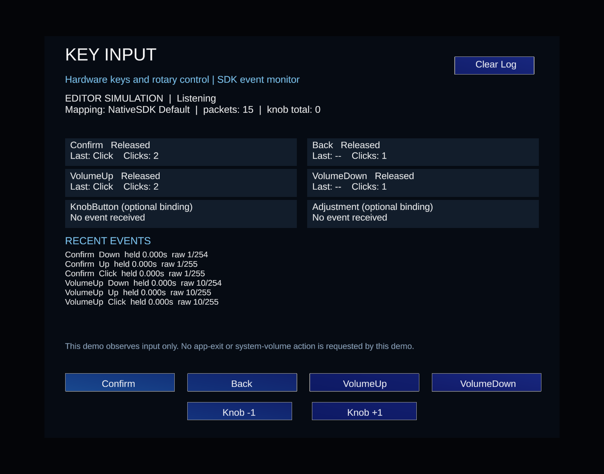

# Key Input Demo

Open `Scenes/KeyInput.unity` for the standard initialized SDK XR sample. The panel is visible in the Unity Scene view before Play Mode. In the Editor, press Play to simulate input; on Android the sample listens for hardware events and hides its simulation controls.

This is an Editor simulation render, not a device screenshot or proof of native input behavior.

## Customer integration

Add `Prefabs/KeyInputDemo.prefab` to an already initialized NativeSDK XR scene. It contains a world-space panel and `SingrayKeyInput`; do not add a second XR rig. The standalone scene supplies the existing SDK `MixedRealityToolkit`, `XvXRInput` and `XvXRManager` host prefabs.

The panel shows listening/mapping state, held keys, last actions, click counts, rotary totals and ten recent events. The default profile maps Confirm, Back, VolumeUp, VolumeDown and rotary ticks. KnobButton and Adjustment remain optional semantic keys requiring a custom mapping; this example does not assign undocumented raw codes.

The demo observes events without requesting app exit or volume changes. OS/Launcher key policies are separate. Clear Log clears the display only. MRTK controls use the existing physical press-cycle guard. Simulation controls call the same queued public input APIs and are unavailable in native mode.

`SingrayKeyInputExample` remains available as the legacy optional OnGUI diagnostic component, but is not attached to this scene. Existing runtime APIs and the scene GUID are retained.

## Editor commands

- `Singray > Input > Build Standard Key Input Demo`: regenerate the optional panel prefab and XR sample scene.
- `Singray > Input > Create Key Input Example Scene`: compatibility menu forwarding to the same builder.
- `Singray > Toolkit > Build Scenes > KeyInput`: build only this scene as an Android APK.

The generator preserves a different saved active scene. Save unsaved work before regenerating the target scene. It does not rebuild or alter the SDK Samples Hub layout.

## Validation

Recorded checks: 23 deterministic core input assertions; 15 Play Mode UI/lifecycle assertions; Android player-script compilation across 27 assemblies; rendered preview inspection. Covered serialized button actions, raw packets, rotary controls, bounded logs, held state, subscription removal/re-enable and input disable/re-enable.

Physical key mapping, rotary direction, native readiness, G2 display placement and near/far hand interaction still require hardware verification. This change has not been installed or launched on the device.
