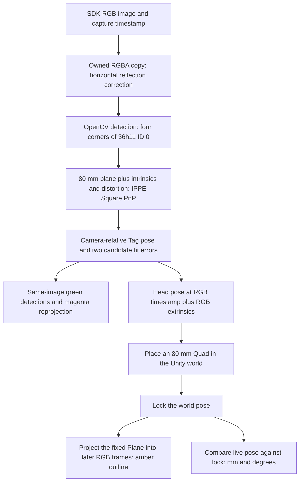

# RGB AprilTag Alignment Diagnostic Demo

RGB-only G2 diagnostic sample with independent OpenCV AprilTag 36h11 detection,
PnP, timestamped world placement, lock comparison, and left-palm MR recording.

This sample helps distinguish image detection and pose fitting, world-coordinate
composition, stability after locking, and recording or optical-display effects.
The target is **AprilTag 36h11, ID 0, with an 80 mm black detection edge**.
It uses no ToF/RGBD and calls no existing SDK AprilTag detector or pose interface.
RGB capture, device calibration, and head tracking still come from the SiNGRAY SDK.
This is an optional SDK sample; existing Demos, Hub layouts, and customer APIs remain available.

## 1. Requirements and entry point

- Unity **2022.3.62f3**, Android IL2CPP / ARM64, MRTK **2.8.3**, and G2 hardware.
- Open `Scenes/RgbTagAlignment.unity` inside this SDK project. This directory is
  a sample, not a standalone Unity project.
- Fetch the repository's AAR/TGZ dependencies with Git LFS. LFS pointer files are
  not usable binary dependencies.
- The Android bridge reuses **OpenCV 4.10.0** from the SDK's `xvsdk-release.aar`
  and the existing `libc++_shared.so`. Do not replace vendor native libraries.
- `Plugins/x86_64/singray_rgb_tag.dll` supports Windows Editor validation and is
  excluded from Android builds.
- Required recording-lifecycle and MRTK button-cancellation fixes are already
  integrated into the SDK. See `Docs~/Publication-Notes.md` for their scope.

## 2. Technical pipeline



### Four automatically detected points

OpenCV decodes the marker and refines its four detection corners to subpixel
positions. No manual point selection is required. The Tag origin is its center;
coordinates are in meters, in the order required by IPPE_SQUARE:

| Corner | Tag coordinate `(x,y,z)` |
| --- | --- |
| Top left | `(-0.04,+0.04,0)` |
| Top right | `(+0.04,+0.04,0)` |
| Bottom right | `(+0.04,-0.04,0)` |
| Bottom left | `(-0.04,-0.04,0)` |

Known marker size supplies metric scale. PnP estimates `T_camera_tag`; it does not
read depth at arbitrary RGB pixels. Incorrect physical size directly affects the
estimated distance. Four coplanar points cannot independently establish absolute
3D accuracy. Duplicate ID 0, invalid or behind-camera poses, and invalid input data
are rejected.

### Intrinsics, reflection correction, and PnP

`API.readRGBCalibration` reads each device's calibration. The sample selects the
record matching the image resolution and validates the dimensions. It uses
`fx, fy, cx, cy, k1, k2, p1, p2, k3`. Default RGB is 1280x720; matching SDK records
for 1920x1080 and 640x480 are also supported.

A horizontal reflection in the tested G2 RGBA feed prevented decoding. Correction
is applied to an owned image copy. Detection, preview, projection, and PNG export
use the same corrected pixel coordinates. The panel shows **X corrected** and
snapshots record `horizontalCorrectionApplied`. Shared RGB pixels are unchanged;
a UI-only flip would not correct the detector input. This convention was verified
on the tested device; other firmware still requires orientation/calibration checks.

`solvePnPGeneric(..., SOLVEPNP_IPPE_SQUARE)` returns planar candidates. The sample
checks positive corner depth, chooses the lowest four-corner reprojection RMSE,
and retains the alternative RMSE. Similar candidates trigger a planar-ambiguity
warning. Default pose acceptance requires RMSE <= 3 px. A small RMSE establishes
fit to these corners, not correct absolute depth, intrinsics, or extrinsics.

### Placement in the Unity world

Let `T_A_B` map B coordinates into A. The image handler queries
`API.xslam_get_pose_at(t_rgb)` rather than using the current render-time head pose:

```text
T_world_tag(t_rgb)
  = T_world_trackingOrigin
  * T_trackingOrigin_tracking(t_rgb)
  * T_tracking_rgb
  * T_rgb_tag
```

The OpenCV-to-Unity conversion uses `S=diag(1,-1,1)` and `B=diag(1,1,-1)`:
`R_unity = S * R_cv * B`, `t_unity = S * t_cv`. `B` also converts the Tag-local
basis so the Unity rotation remains a proper rigid rotation.
RGB extrinsics follow the existing SDK convention: `S * T_native * S`, composed
as a full transform with timestamped tracking. Adding translation vectors alone
would omit the rotation of the camera-relative translation.

Extrinsic direction, tracking frames, and physical timestamp semantics still
require hardware verification; a matrix round trip does not prove physical
accuracy. Apply the resulting pose to a unit XY Quad scaled to
`(0.08,0.08,0.08)` for an 80 mm Plane. No manual offset, size compensation, or
smoothing is applied. Nonrigid transforms, missing timestamped tracking, and a
nonidentity SDK reset rotation are rejected. Restart after tracking reset or
relocalization. Native matrix layout and output fields are documented in
`Native~/rgb_tag.cpp` and `Scripts/RgbTagNative.cs`.

### What Lock freezes

**Lock** requires a fresh valid pose and copies `T_world_tag` into a fixed
reference. Later detections do not move that Plane. Detection continues, showing
the translation norm in mm and rotation difference in degrees against the lock.
The amber outline in later RGB frames uses
`T_rgb_tag_locked = inverse(T_world_rgb) * T_world_tag_locked`, including distortion.

**The orange world-Plane outline is also visible in LIVE mode. Its presence does
not establish a successful lock.** Confirm **LOCKED** and **Live vs lock** values.
If no current valid comparison is available, the panel reports that the reference
is retained. Tag loss retains a locked Plane. Unlock hides it without a fresh
valid pose; Stop clears the Plane and lock. Recenter UI moves only the panel.

## 3. Test procedure

1. Print `Markers/AprilTag36h11_ID0_80mm_A4.svg` at **100% / actual size**. Measure
   the black detection square as **80x80 mm**, excluding the white margin. Mount
   the marker flat on a rigid support and show only one ID 0.
2. Launch normally through **MPLauncher**. Installation does not automatically
   launch through ADB. Press Start and wait for RGB, green corners, and magenta fit.
3. Observe while stationary. Keep the control panel clear of the physical Tag so
   its opaque background does not hide the recording's comparison target.
4. Press Lock and confirm **LOCKED + Live vs lock**. Keep the board stationary.
   Wait five seconds, move sideways and closer/farther, view obliquely, and return
   to the starting position. Suggested measured distances: 0.4, 0.7, and 1.0 m.
   Do not move both the board and glasses when measuring drift.
5. At each stationary position, use Save alongside video to retain images,
   matrices, calibration, and timestamps. Stale frames cannot be saved or locked.
6. Compare LIVE and LOCKED. Repeat several times on a second device using the
   same board, distances, and lighting, with that device's own calibration.
   Do not directly subtract world coordinates from different SLAM origins.

| Observation | Checks to prioritize; these are diagnostic directions, not proof of cause |
| --- | --- |
| Decoding fails or corners are unstable | Family/ID, reflection, complete border, blur, exposure, resolution, board |
| Magenta and green differ substantially | Corner quality, distortion model, PnP candidate, image/calibration match |
| Good same-frame fit but persistent spatial offset | Physical size, extrinsic direction/basis, camera/display viewpoint, composite projection |
| Error mainly during fast motion, recovering at rest | Image/tracking timing, detection age, recording timing, exposure blur |
| LOCKED reference changes or fails to realign after returning | Tracking drift/relocalization, extrinsics, timing; first verify stationary board and confirmed lock |
| One device repeatedly differs from others | Per-device calibration or mechanical differences; repeat under matched conditions |

Raw RGB may contain lens distortion; an ordinary Unity camera projection does not
provide the complete lens-distortion model. Test recording alignment near image
edges separately. Avoid empirical offsets that could hide the source of error.

## 4. Left-palm recording and Save data

Open the left palm and press **Record**. After a real RGB frame arrives, the main
panel shows red **REC** and the palm shows **Stop**. Waiting offers Cancel and
expires after ten seconds without a frame. After Stop, wait for Saving... then
Saved. Repeated starts are blocked during saving.

Hiding the palm, Lock/Unlock, or stopping detection does not end an active recording.
Pause/disable requests finalization; forced process termination cannot guarantee
saving. Recording reuses SDK `XvMRVideoCaptureManager`, `XvMediaRecorderManager`,
and `ReplayCam`: no microphone/audio track, maximum 1280-pixel long edge.
Android normally exports to `/sdcard/DCIM/guest`. If export fails, the encoder
file is retained. `[RGB-TAG-REC] Saved: <path>` and `LastSavedPath` identify it.

The recording is an **RGB-camera-view MR composite**, including visible Plane,
preview, and Unity UI. It does not capture the wearer's optical see-through eye
view. Preview processing defaults to **8 Hz** and updates after asynchronous
detection completes. Recording background and world rendering follow separate
timing; motion does not imply every element uses the same exposure frame.
Container frame rate is not fresh RGB/detection rate. MP4 alone cannot measure
absolute spatial error in millimeters.

Save writes a PNG/JSON pair under `Application.persistentDataPath/RgbTagAlignment`:
processed image, RGB timestamp, size/intrinsics/distortion, 31 native results,
RGB extrinsics/world matrices, tracking validity, lock state/matrix, reflection
correction, and errors. PNG pixels match detection/projection coordinates. Check
validity flags and timestamps before comparing captures.

## 5. Build, validation, and directories

Unity menu **Singray > RGB Tag Alignment**:

- **Build G2 APK**: build this scene only, temporarily using package
  `com.singray.rgbtagalignment`, version 1.2/code 3, then restore project settings.
- **Validate Independent Demo**: saved references, actual Windows bridge,
  synthetic poses, basis conversion, lock/loss/staleness, and snapshot checks.
- **Validate Recording Lifecycle**: injected Play Mode recorder verifies shared
  ownership and async saving. Its five-byte fixture files are not playable MP4s.
- **Add Left-Palm Recording**: add this sample's recording menu idempotently.
- **Prepare Independent Demo**: regenerate only this sample during development;
  switch to another saved scene first. Regeneration is not needed to run it.

Internal reproducibility tools are in repository `Tools/RgbTagAlignment`:

```text
python -m pip install opencv-contrib-python numpy
python Tools/RgbTagAlignment/validate_native.py
# Generate synthetic-rgb.rgba before Unity's Validate Independent Demo.
python Tools/RgbTagAlignment/verify_apk.py <generated-apk-path>
```

`build_native.py android` / `windows` uses checksum-pinned OpenCV 4.10.0 source.
Adjust Unity/VS paths for the development machine. `Native~` retains C++/CMake;
prebuilt bridge libraries can be used directly. Retain OpenCV Apache 2.0 and
static-dependency notices; vendor libraries retain their original license terms.
`Editor` and `Tools` are development checks, not new customer runtime dependencies.

## 6. Evidence and remaining work

- Version 1.1 corrected reflection; the user confirmed normal Launcher startup,
  image orientation, detection outlines, and Plane visibility.
- Version 1.2 passed 243 historical Editor/native/controlled checks and 30 recorder
  fixture assertions in the original workspace, then built and installed.
- The reviewed clip decodes as 32.08 seconds, 1280x720, 2830 video frames, with real
  image, Plane, UI, and palm recording state. This does not establish fresh RGB or
  detector rate, or stability on all devices/firmware.
- Readable video states are LIVE; there is no confirmed LOCKED walk-around segment.
  Locked drift and a single-device calibration fault are not established.
- See [video review](Docs~/Video-Review-2026-11-16.md) for observations, evidence
  limits, and the next fixed-board test. Raw video, device calibration, and full
  workspace screenshots are not published with the sample.
- Absolute world accuracy, optical alignment, cross-device calibration, thermal
  stability, and comprehensive Android 15+ compatibility remain unverified.

The publication checkout also passed 233 headless Editor/native assertions,
30 recording assertions, 15 native synthetic cases, and Android Player script
compilation. The original workspace subsequently passed 246 assertions including
private replay/fixture checks and visual rendering; those are different evidence
sets, not interchangeable hardware results. See `Docs~/Validation-Receipt.json`
for publication and post-merge validation records.
