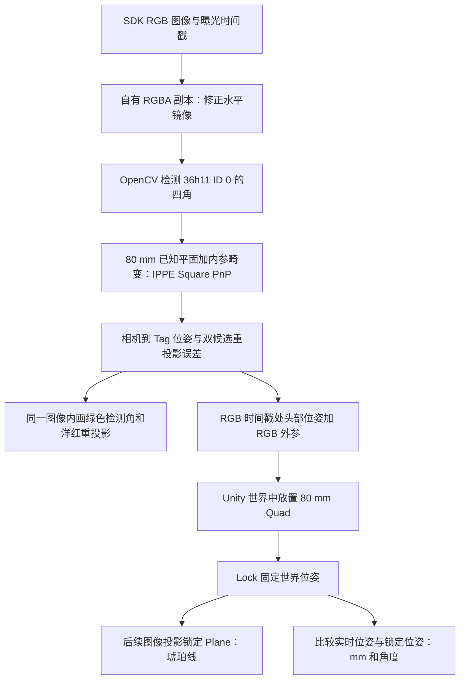

# RGB AprilTag 空间对齐诊断 Demo

RGB-only G2 diagnostic sample: independent OpenCV AprilTag 36h11 detection and
PnP, timestamped world placement, lock comparison and left-palm MR recording.

用于区分「图像识别/位姿求解」「世界坐标转换」「锁定后的空间稳定性」和「录屏/光学显示」的问题。
固定目标为 **AprilTag 36h11，ID 0，黑色检测边长 80 mm**。
不使用 ToF/RGBD，不调用 SDK 原有 AprilTag 检测或位姿接口；RGB、标定与头部追踪仍来自 SiNGRAY SDK。
本目录是可选 SDK 示例，原有 Demo、Hub、场景布局和客户 API 保留。

## 1. 环境与入口

- Unity **2022.3.62f3**，Android IL2CPP / ARM64，MRTK **2.8.3**，G2。
- 在本仓库 SDK 工程中打开 `Scenes/RgbTagAlignment.unity`；目录本身不是独立 Unity 工程。
- Git LFS 必须拉取仓库原有 AAR/TGZ 等依赖；不要把 LFS 指针当二进制文件使用。
- Android 原生桥接复用 SDK `xvsdk-release.aar` 中的 **OpenCV 4.10.0** 和原有 `libc++_shared.so`，不得替换供应商库。
- `Plugins/x86_64/singray_rgb_tag.dll` 仅供 Windows Editor 验证，Android 包排除该 DLL。
- 本示例依赖已集成到 SDK 的录制生命周期和 MRTK 按钮取消保护修正，清单见 `Docs~/Publication-Notes.md`。

## 2. 技术路线



### 四个点怎么来

OpenCV 自动解码目标板并提取四个检测角，使用亚像素细化，不需要用户点击。
目标坐标在 Tag 中心，单位米，PnP 输入按 IPPE_SQUARE 要求排列：

| 顺序 | Tag 坐标 `(x,y,z)` |
| --- | --- |
| 左上 | `(-0.04,+0.04,0)` |
| 右上 | `(+0.04,+0.04,0)` |
| 右下 | `(+0.04,-0.04,0)` |
| 左下 | `(-0.04,-0.04,0)` |

这四点的已知尺寸提供尺度，PnP 解出 `T_camera_tag`；不是从 RGB 任意像素直接读取深度。
尺寸量错会直接影响估计距离。一个平面四角不能独立证明绝对三维精度。
检测到多个 ID 0、无效/相机后方位姿或不合格数据时拒绝放置。

### 内参、镜像与 PnP

从每台眼镜读取 `API.readRGBCalibration`，按当前图像分辨率选择标定，校验图像尺寸与标定尺寸。
使用 `fx, fy, cx, cy, k1, k2, p1, p2, k3`。
默认 1280×720；同时支持 SDK 提供标定的 1920×1080 和 640×480。

G2 实测 RGBA 水平反射会阻止解码。本示例在自有图像副本中修正，检测、预览、投影和 PNG 均使用同一修正后的像素坐标。
界面显示 **X corrected**，保存记录包含 `horizontalCorrectionApplied`。不修改共享 RGB 数据，不靠只翻 UI 来掩盖问题。
这是已验证设备的约定；其他固件仍应核对原图、镜像和标定的对应关系。

`solvePnPGeneric(..., SOLVEPNP_IPPE_SQUARE)` 求平面候选，检查四角深度为正，选择四角重投影 RMSE 最小者，同时保留次优 RMSE。
两候选接近时提示平面歧义。默认显示位姿要求 RMSE ≤ 3 px；小 RMSE 只是当前四角拟合好，不等于内外参或绝对深度已经正确。

### 如何放到 Unity 世界中

用 `T_A_B` 表示「把 B 坐标变换到 A」，处理图像时查询 `API.xslam_get_pose_at(t_rgb)`，而不是直接用渲染时刻头部位姿：

```text
T_world_tag(t_rgb)
  = T_world_trackingOrigin
  × T_trackingOrigin_tracking(t_rgb)
  × T_tracking_rgb
  × T_rgb_tag
```

OpenCV 相机到 Unity 相机转换：`S=diag(1,-1,1)`、`B=diag(1,1,-1)`，
`R_unity = S × R_cv × B`，`t_unity = S × t_cv`；`B` 同时转换 Tag 局部基，保持 Unity 旋转为刚性旋转。
RGB 外参按现有 SDK 约定转换为 `S × T_native × S`，再与带时间戳的追踪位姿完整相乘，不能只把两个位置向量相加。
外参方向、追踪坐标和时间戳物理语义仍需真机验证；通过矩阵往返测试不构成物理证明。

把最终位姿赋给单位 XY Quad，缩放为 `(0.08,0.08,0.08)`，得到 80 mm Plane。
无手动偏移、尺寸补偿或平滑。拒绝非刚性矩阵、无时间戳追踪和非单位 SDK 重置旋转；重定位/重置后重新开始测试。
原生矩阵布局和输出字段见 `Native~/rgb_tag.cpp`、`Scripts/RgbTagNative.cs`。

### Lock 具体锁什么

**Lock** 只接受新鲜有效位姿，将 `T_world_tag` 复制为固定参考，之后不再随检测结果更新 Plane。
识别继续运行，显示实时估计对锁定参考的位移范数（mm）和旋转角（deg）。
后续 RGB 中琥珀线使用 `T_rgb_tag_locked = inverse(T_world_rgb) × T_world_tag_locked`，包含畸变投影。

**世界 Plane 的橙色边框在 LIVE 也存在，不能用“出现橙框”判断锁定成功。**
必须看到 **LOCKED** 状态和 **Live vs lock** 数值；无当前有效比较时会显示固定参考保留的提示。
Tag 丢失保留已锁定 Plane；Unlock 后没有新鲜位姿则隐藏；Stop 清除锁定与 Plane。
Recenter UI 只移动控制面板，不移动锁定 Plane。

## 3. 正确测试步骤

1. 按 **100% / 实际大小** 打印 `Markers/AprilTag36h11_ID0_80mm_A4.svg`。
   测量黑色检测方形 **80×80 mm**，不含白边，固定在平整硬板/墙面，场景只留一个 ID 0。
2. 从 **MPLauncher** 正常启动。安装流程不自动 ADB 启动，按 Start 后等待图像、绿色角点和洋红重投影。
3. 先静止观察；让控制面板避开物理 Tag，以免录屏中的不透明面板遮挡比较对象。
4. 按 Lock 并确认 **LOCKED + Live vs lock**。纸板保持不动，先静止 5 秒，再左右移动、前后移动、斜视并返回起点。
   可先在 0.4、0.7、1.0 m 分别测，记录实际距离。不要同时移动纸板与眼镜来估计漂移。
5. 每个静止位置按 Save，配合录屏保留图像/矩阵/标定/时间戳。帧过期会拒绝保存或锁定。
6. 对照 LIVE 与 LOCKED；再用另一台设备在相同目标板、距离和光照下重复，分别读取各自标定。
   不直接比较两台设备不同 SLAM 原点的原始世界坐标。

| 观察 | 优先检查；这些是诊断方向，并非单凭现象定因 |
| --- | --- |
| 解码失败/角点不稳 | 家族/ID、镜像、边框完整、模糊、曝光、分辨率、纸板 |
| 洋红与绿色差得多 | 角点质量、畸变模型、PnP 候选、图像与内参匹配 |
| 同帧拟合好但空间稳定偏移 | Tag 尺寸、外参方向/坐标基、相机与显示视角、合成投影 |
| 只在快动明显，停下恢复 | 图像/追踪时间匹配、检测延迟、录屏时序、曝光运动模糊 |
| LOCKED 后持续变化或返回不重合 | 追踪漂移/重定位、外参、时序；先确认纸板静止和锁定有效 |
| 一台持续异常、其他设备重复正常 | 该机标定/安装差异值得复核，需相同条件的多轮数据 |

原始 RGB 可能含镜头畸变，Unity 普通相机投影本身不提供完整镜头畸变模型；边缘位置的录屏叠加误差需要单独核对。
不要为了“看起来贴合”先加经验偏移，这会掩盖原因。

## 4. 左掌录屏与 Save 数据

翻开左掌点 **Record**；真实 RGB 帧就绪后主面板显示红色 **REC**、左掌显示 **Stop**。
等待时可 Cancel，10 秒无帧取消；Stop 后等待 Saving… → Saved。保存期间禁止重复开始。
收起手掌、Lock/Unlock 或停止识别不停止正在进行的录制；暂停/禁用会请求收尾，强杀进程不能保证保存。

录制复用 SDK `XvMRVideoCaptureManager` + `XvMediaRecorderManager` + `ReplayCam`，
视频无麦克风/无音轨，长边最多 1280 像素。Android 默认导出 `/sdcard/DCIM/guest`；
导出失败时保留编码器原文件，`[RGB-TAG-REC] Saved: <path>` 和 `LastSavedPath` 给出真实路径。

录屏是 **RGB 相机视角的 MR 合成**，包括视野内的 Plane、预览和 Unity UI，不能直接记录透过镜片看到的光学眼位。
预览默认 **8 Hz**，异步检测完成后才更新；录屏背景与世界渲染是另一条时序，运动时不能假设各处内容来自同一曝光帧。
容器帧率不等于新的 RGB 帧率或识别率，也不能用 MP4 直接量毫米误差。

Save 输出 `Application.persistentDataPath/RgbTagAlignment` 下的一对 PNG/JSON：
当前处理图像、RGB 时间戳、尺寸/内参畸变、31 项原生结果、RGB 外参/世界矩阵、是否锁定与锁定矩阵、追踪有效性、镜像修正及错误状态。
PNG 像素和检测/投影坐标保持一致；跨数据比较前先检查有效标志和时间戳。

## 5. 构建、验证与目录

Unity 菜单 **Singray > RGB Tag Alignment**：

- **Build G2 APK**：只构建本场景，临时使用独立包名 `com.singray.rgbtagalignment`、1.2/code 3，恢复原项目身份与设置。
- **Validate Independent Demo**：保存引用、真实 Windows 原生桥接、合成位姿、坐标变换、Lock/丢失/过期、导出等检查。
- **Validate Recording Lifecycle**：Play Mode 注入录制器，验证共享占用和异步保存；测试导出是五字节占位文件，不是可播放 MP4。
- **Add Left-Palm Recording**：仅向本示例内容 Prefab 增加录制菜单，重复执行不会叠加。
- **Prepare Independent Demo**：重新生成本示例。仅开发时需要；先切到另一已保存场景。无需为运行现有场景重新生成。

内部可复现工具在仓库 `Tools/RgbTagAlignment`：

```text
python -m pip install opencv-contrib-python numpy
python Tools/RgbTagAlignment/validate_native.py
# 先生成 synthetic-rgb.rgba，再运行 Unity 的 Validate Independent Demo
python Tools/RgbTagAlignment/verify_apk.py <生成的APK路径>
```

`build_native.py android` / `windows` 使用校验固定的 OpenCV 4.10.0 源码；本机 Unity/VS 路径需按开发环境调整。
`Native~` 保留 C++ 源码和 CMake；预编译库可直接使用。保留 OpenCV Apache 2.0 及静态依赖通知，供应商库继续遵循原有许可。
`Editor` 和 `Tools` 为开发验证工具，不是客户运行时的新依赖。

## 6. 已验证范围与未解决事项

- 1.1 修正图像反射；用户已确认正常 Launcher 启动、图像/边框/Plane 出现。
- 1.2 在原工作区通过 243 项 Editor/原生/受控检查及 30 项录制生命周期检查，构建安装成功。
- 最新样本视频可完整解码为 32.08 秒、1280×720、2830 个视频帧，内容包含真实图像、Plane、UI 和左掌录制状态；
  这些数字不证明实际 RGB/识别刷新率，也不证明每种设备/固件稳定。
- 当前视频中可读状态为 LIVE；没有确认的 LOCKED 走动段，不能认定锁定漂移或单机标定故障。
- 详细观察、证据边界和下一轮测试见 [视频分析](Docs~/Video-Review-2026-11-16.md)。原视频、设备原始标定和工作现场完整截图不随示例上传。
- 不宣称世界定位精度、眼位叠合、跨设备标定、热稳定性或 Android 15+ 全面兼容性已通过验收。

本次发布检出另通过 233 项无图形 Editor/原生检查、30 项受控录制检查、15 个原生合成用例及 Android Player 脚本编译。
本地私有回放额外验证后为 246 项；与发布检出差异来自私有帧及图形渲染，不能混为同一组硬件结果。
发布校验明细见 `Docs~/Validation-Receipt.json`。
