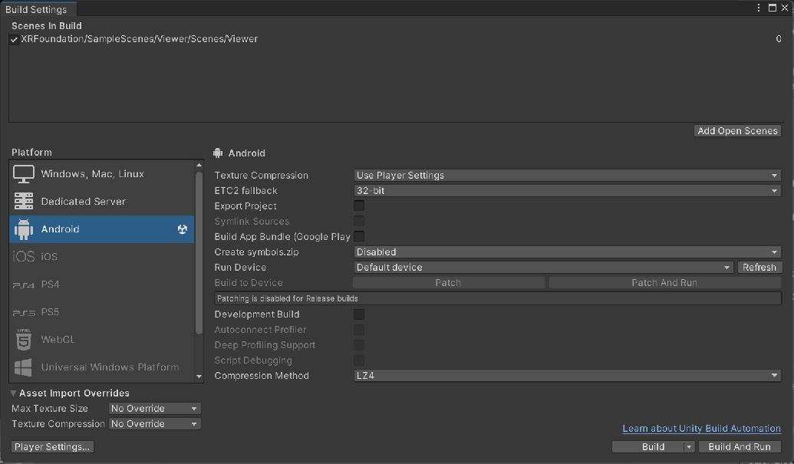

# SiNGRAY G2 Native SDK: Demo and User Guide

This guide covers the `dev/4.2` Unity project, its sample applications, and the workflow for building and running applications on SiNGRAY G2 devices. The configured product version is `4.2.0.2`, a development build. Hardware behavior must be verified on the target device and firmware.

For application interfaces, settings, events, and examples, see the [API Reference](API-Reference.md).

For hardware-key setup, the key-input example, and MRTK button behavior, see [Keys and MRTK Buttons](Keys-and-Buttons.md). This includes checks for repeated actions when pressing and releasing hand-menu buttons.

See the [Release Notes](../RELEASE_NOTES.md) for changes since October 6, 2026. The current Android version code is `2`; the SDK and application version are `4.2.0.2`.

## 1. Development environment

| Component | Project configuration |
| --- | --- |
| Unity Editor | `2022.3.62f3` |
| Build target | Android |
| Scripting backend | IL2CPP |
| CPU architecture | ARM64 |
| Minimum Android API | 30 |
| Target Android API | 35 |
| Android application identifier | `com.singray.SDK` |
| MRTK packages | 2.8.3, provided as local package archives |
| Large binary storage | Git LFS for `.aar` and `.tgz` files |

Install Android Build Support and the corresponding SDK, NDK, and OpenJDK through the Unity installation workflow. Use the recorded Editor version where available; validate any substitute version before adopting it for device builds. Git must be available for the Git-based package dependency in `Packages/manifest.json`.

The editor version is recorded in `ProjectSettings/ProjectVersion.txt`; the package lock uses the `packages.unity.com` registry. This branch remains on Unity 2022, not Unity 6. Changing the Unity Hub language does not migrate a project or validate native SDK compatibility.

## 2. Obtain the project

With Git and Git LFS installed, run:

```sh
git lfs install
git clone --branch dev/4.2 git@github.com:HMS-Unity/SiNGRAY_G2_NativeSDK.git
cd SiNGRAY_G2_NativeSDK
git lfs pull
git lfs fsck
```

The SSH command requires a GitHub SSH key configured for your account. HTTPS can also be used with the same repository and branch.

Open the repository root in Unity Hub. Wait for package resolution and asset import to complete before opening a scene or building. The MRTK archives under `Packages/MixedReality` must be actual binary files, not small text files containing LFS pointers.

Keep an AAR and its `.meta` file together when replacing a native library. The metadata preserves Unity asset identity and Android import settings. Do not infer the native SDK version from the Unity application version: these are separate version identifiers.

## 3. Choose a demo entry point

Scene paths below are relative to `Assets/XRFoundation/SampleScenes/`.

| Entry point | Scene path | Purpose |
| --- | --- | --- |
| Camera Viewer | `Viewer/Scenes/Viewer.unity` | Camera and sensor stream controls; the currently enabled build scene |
| Sensor diagnostics | `Viewer/Scenes/Sensor.unity` | Sensor inspection and calibration-related controls |
| SDK Samples Hub | `SDKSampleHub/Scenes/SDKSamples.unity` | Categorized navigation across feature modules |
| MRTK2 | `MRTK2/Scenes/MRTK2.unity` | Mixed reality interaction example |

The checked-in Build Settings currently contain only the Camera Viewer scene. To launch another entry point, open **File > Build Settings**, add that scene, and place it first among enabled scenes. Opening a scene in the Editor does not automatically change the scene launched by a previously built APK.

### SDK Samples Hub

The hub keeps a shared XR rig and instantiates feature module prefabs. Select a category, then a sample. Use the Home action to leave the active sample; Escape or Backspace also returns home when a sample is active. Where the left-hand menu is available, its controls include Samples, Home, Hide, and MR Recording.

The hub provides the following modules:

| Category | Modules | Suggested verification |
| --- | --- | --- |
| Sensors & Cameras | Camera Viewer, RGBD, ToF Point Cloud, MR Video Capture | Start one feature, inspect its output, and stop it before switching |
| Spatial Understanding | Plane Detection, Spatial Map, Spatial Mesh, Tag Recognizer | Use a textured environment and the appropriate marker or map data |
| Interaction | Keyboard, Static Gesture, MRTK2 | Verify text entry, gestures, hand rays, and UI selection on hardware |
| Media & System | Media Recorder, RTSP Streamer, System Settings | Verify recording output, network streaming, and device settings |

Additional feature scenes exist under the sample folders, including Bluetooth, Wi-Fi, and speech examples. Their presence does not guarantee support on every G2 hardware or firmware configuration.

The Editor command **Singray > XR > SDK Samples > Rebuild Hub Scene** regenerates the hub and related assets. Use it when intentionally rebuilding the hub; save scene changes first. It is not required for a normal build of the checked-in hub.

## 4. Build and install



Actual Editor screenshot, October 7, 2026. The image illustrates scene selection and the Android target only. It does not show a successful build or sensor output from a device.

1. Switch the active platform to Android in Build Settings.
2. Confirm the entry scene and enabled scene order.
3. Check Player Settings against the configuration table above.
4. Connect the G2 device, enable USB debugging, and accept its computer authorization prompt.
5. Use **Build And Run**, or build an APK and install it with ADB.

```sh
adb devices
adb install -r path/to/SiNGRAY-G2.apk
adb shell monkey -p com.singray.SDK -c android.intent.category.LAUNCHER 1
```

Launch the application on the device and grant requested permissions needed by the selected feature. If installation reports an incompatible signing certificate, use the same signing configuration as the installed application or deliberately remove that installation after preserving its data.

## 5. Use the sensor demos

### Camera preview

Start a single stream from the Viewer controls and confirm that its image changes with the physical scene. Viewer contains RGB, ToF depth, ToF infrared, MR preview, left/right fisheyes and additional **Fisheye 2 / Fisheye 3** panels. The Compute Unit panel is hidden; its underlying SDK API remains available. Actual stream availability depends on the device.

The additional fisheyes occupy the former Compute Unit slot and the vacant middle-right slot; original panels retain their positions and sizes. Start/Stop controls operate each fisheye independently. On a four-camera G2, verify that all four previews show distinct physical views, then stop/restart one while the others continue. Channels 2/3 refuse unsupported calibration counts and report a ten-second first-frame timeout. ToF depth and IR previews are mirrored horizontally through their UV coordinates; raw frame data and metric coordinates are unchanged. Device rendering and physical button operation require hardware validation.

Start with the configured RGB default of 1280 x 720 at 30 FPS and ToF QVGA at 30 FPS. The API exposes additional modes, but a mode must be supported by the connected hardware. Stop an active stream before changing settings and restarting it.

### RGBD and point clouds

Use the RGBD sample to exercise RGB pixel-to-3D queries. Queries use image pixel coordinates, not Unity screen coordinates; convert UI coordinates to the camera image dimensions first. Treat a failed query as unavailable data rather than a valid origin point.

Use the ToF Point Cloud sample to inspect depth-derived geometry. Allow time for the first data frame and validate scale and orientation against a known scene. Display textures are previews and should not be treated as raw metric depth measurements.

Point colors now show distance from the main viewing camera: warm yellow nearby, green in the middle, and bright blue farther away, with a fixed 0.5–5 m visualization range. Colors saturate outside that range; they are a visual aid, not confidence values or RGB texture colors. Without a `MainCamera`, the fallback reference is world origin. The `Color By Distance` Inspector option on `XvParticlesCloudPoint` can restore the original solid blue appearance. Particle size, sampling density, capture APIs, ASC data and all existing host layouts are unchanged. This shared script supplies the standalone scene, legacy menu, Hub and existing variants. Actual G2 visibility and performance remain to be tested.

The reusable RGBD sample is `Assets/XRFoundation/SampleScenes/Rgbd/Prefabs/RgbdDemo.prefab`, with the `RgbdDemo` component. It contains the preview, selection marker, world-point sphere, and configured RGBD/camera services. Use it in an SDK-initialized XR scene; the prefab does not replace SDK initialization or the XR/input rig. `XvRgbdDemo` remains its compatibility base, so existing source references and component lookups continue to work.

The standalone scene (`SampleScenes/Rgbd/Scenes/Rgbd.unity`), BaseScene RGBD entry, and Hub RGBD module retain their own original layouts. Existing hosts use their original preview and services, with the prefab's embedded replacements disabled. The Hub keeps its original simple preview without adding a 2D selection marker. Its module prefab is the Hub generator's RGBD source; no Hub UI rebuild is needed for this cleanup.

Enabling RGBD starts capture automatically after SDK readiness (up to ten seconds). Arrow keys move the selection across the preview; the standalone/legacy marker shows that selection. The sample maps it to the actual incoming texture dimensions, including the retained preview material's double-axis flip and UV coordinates. A successful query moves only the world-point sphere. No frame, a frame older than two seconds, or an invalid result hides the sphere; an empty preview is not evidence of available RGB/depth. Duplicate timestamps do not refresh the stale-frame timeout.

Disabling the demo removes its event handler, clears the borrowed preview texture, and releases RGBD capture. RGBD and camera-manager RGB/depth consumers share stream ownership; stopping one owner retains capture for the others. Match camera Start/Stop calls per manager instance, and test repeated entry/exit on hardware. Device pixel/world alignment and sensor timing remain pending until tested on G2.

Starting the ToF Point Cloud demo now enables its drawing loop directly; pressing the Up Arrow key is no longer required to enable drawing. Pending native startup is cancelled when stopped. Leave the sample through Home and reopen it to verify repeated startup and cleanup.

### Calibration diagnostics

The `XvSensorCalibrationDump` component provides RGB, ToF, and stereo dump actions. Start the corresponding stream and wait for frames before requesting calibration. The component includes readiness checks and an eight-second default timeout. Its output is written to a text file; use the reported output path to retrieve it.

Do not call low-level calibration reads before sensor initialization. The native implementation can fail outside the scope of managed exception handling.

## 6. Spatial, interaction, and media demos

**Spatial understanding:** Start the selected detection feature and inspect its visual output. For maps, save a map and use its returned path when loading it again. Observe completion events and the sample status rather than assuming that a save or load call completes immediately. Marker recognition requires the selected recognizer mode and suitable target data.

**SpatialMap sample:** `SampleScenes/SpatialMap/Prefabs/SpatialMapDemo.prefab` contains configured map services, its original UI/feature-point display, and referenced sample objects. It requires an initialized SDK XR scene. Standalone, BaseScene and Hub hosts keep their original managers/environment and disable the embedded duplicates; the Hub generator reuses the configured module. Public APIs, original GUIDs, UI transforms and the `CslamMap.txt` content schema remain compatible.

Create Map resets tracking to start scanning from a new origin. Enable FeaturePoint to inspect points, then use Save Map to request a `.bin` file. Wait for the native completion callback before another create/save/load operation. The sample records a map entry only when the callback corresponds to its pending path and the file exists with nonzero length. Raw status and quality are displayed without inventing a success threshold. Nonempty bytes alone do not establish native map-format validity or localization quality. Selecting an existing entry loads it and restores the associated named objects; matching similarity is a separate update, not Create Map progress. Empty files are omitted from the list without deleting the underlying files.

Feature drawing reuses its particle array and no longer forces garbage collection each refresh; exit clears particles, scratch storage and scene event subscriptions. Managed validation covers request rejection, serialization, callback/path correlation, empty files, latest-value similarity updates and particle cleanup. The previously captured Create Map native pose-lock stall remains a hardware/vendor issue: these workflow guards must not be treated as proof of its resolution. Evidence: `Builds/SpatialMapFreeze_20261028_1501`; current cleanup evidence: `Builds/SpatialMapCleanup_20261030`.

**SpatialMesh sample:** `SampleScenes/SpatialMesh/Prefabs/SpatialMeshDemo.prefab` contains the existing panel, arrow/line references and configured mesh services. Add it to an SDK-initialized XR scene with the existing hand-input/MRTK setup. It does not provide another XR rig. Standalone, BaseScene and Hub hosts bind their original services and disable the embedded duplicates; their original transforms, visibility, material, manual/automatic scan defaults and button wiring are retained. The Hub generator reuses its configured module.

Use StartDetection/StopDetection to scan; pending startup can be cancelled by the same button. Render and Collider remain independent switches. Arrow and Line keep their original placement controls; Clear removes the respective annotations. Leaving the demo stops its scan and removes its annotations. Native reconstruction is shared across manager instances; the final active manager stops it. Direct native API calls bypass this ownership.

The visualizer copies callback data into a latest-value queue per map ID and applies at most four surface updates each frame. It reuses the object and Mesh for repeated IDs, releases generated Mesh resources on destruction, and avoids creating material copies. Empty geometry removes the corresponding surface. Large surfaces use 32-bit indices; malformed payloads are rejected. Disabling the visualizer clears pending updates; already displayed geometry is retained until the visualizer's object is destroyed. `[MESH-LIFE]` logs report scan ownership, applied updates, pending IDs and render/collision states. Source/managed validation does not establish G2 scan fidelity, FPS, physical interaction or long-run memory behavior. Evidence: `Builds/SpatialMeshCleanup_20261030`.

**TagRecognizer sample:** `SampleScenes/TagRecognizer/Prefabs/TagRecognizerDemo.prefab` contains the original recognition panel, configured camera/recognition services and four reference tag targets copied from the standalone sample. Add it to an SDK-initialized XR scene with the existing input/MRTK setup. It does not add an XR rig. `TagRecognizerDemo` derives from the retained `XvTagRecognizerDemo` compatibility type; the former sample script and prefab GUIDs are preserved. Existing host GameObject names stay unchanged; the renamed standalone prefab asset has the neutral root name `TagRecognizerDemo`.

The standalone scene retains its unpacked UI variant, four targets, fisheye default and 0.3 m configured tag size. BaseScene and Hub retain their original panel instances, single target, stopped default and original size configuration; the new embedded service copies are disabled in these hosts. The Hub generator reuses its configured module. Existing UI transforms, materials, tag IDs/QR filters and persistent event wiring remain intact. Two disabled standalone measurement-line objects already have missing scripts; they are retained as a separate known issue, not removed during recognition cleanup.

Select `RGB_QRCode`, `RGB_Apriltag` or `FishEye_Apriltag`, and set the actual printed tag size in meters using the existing size buttons/custom value. AprilTag uses the `36h11` family. The QR target filter keeps substring matching; an empty filter accepts any nonempty QR content. Invalid/empty sizes retain the previous value. `StopTagDetector` stops recognition and clears detector snapshots. Per-target Start/Stop keeps its original pose-freeze behavior. Found/Lost UnityEvents keep continuous delivery; their configured visual actions decide whether a target remains visible when tracking is lost.

Recognition waits for SDK readiness (ten-second timeout). RGB consumers acquire/release their own shared camera occupancy. Identical manager configurations share a native session; a manager cannot change a session still owned by another manager. Fisheye polling runs on a stored background thread at up to 50 queries/second; stop cancels publication immediately and lets the current native call finish without joining it on the Unity main thread. A new mode waits for that native cleanup. If a native call never returns, the new start times out and retains the stop gate rather than overlapping detectors.

Native results are copied and delivered once per render frame on the Unity main thread. Empty results and snapshots older than two seconds produce Lost updates; stopping/disabling clears the local result and releases this manager's occupancy. QR text is decoded up to the first NUL byte. `[TAG-LIFE]` logs include requested/started/stopped modes, worker completion, result batches, freshness and Found/Lost transitions. Batch count is not measured sensor FPS. Native callback ordering after stop, physical tag/QR pose accuracy, repeated transitions, device FPS and long-run memory still require G2 verification. Evidence: `Builds/TagRecognizerCleanup_20261030`.

**StaticGesture sample:** `SampleScenes/StaticGesture/Prefabs/StaticGestureDemo.prefab` contains the original left/right labels and a configured gesture manager. Add it to an SDK-initialized XR scene with its existing hand-input provider; it does not create another hand tracker, XR rig or camera stream. `StaticGestureDemo` derives from the retained `XvStaticGestureDemo` compatibility type. The original script/prefab GUIDs are preserved, while existing standalone/BaseScene/Hub instance names and layouts stay unchanged. These hosts bind their original manager and disable the newly embedded duplicate; the Hub generator reuses its configured module.

The original labels show the native left/right gesture names, including the legacy `UNKONOW` spelling for unknown/untracked data. All ten gesture codes map independently: GRAB, Point, VICTORY, Three, Four, OpenHand, Call, Rock, Thumb and Pinch. The five latter mappings that incorrectly reused Four are corrected. Each manager samples each hand once per rendered frame, so multiple consumers read the same down/held/up state without consuming its edge. Held state is true on the first press frame. Missing/short status arrays, invalid codes and hands not marked tracked return unknown; losing a tracked hand releases its held gesture once. This uses the existing native provider's validity flags rather than adding a new tracking provider or timestamp policy.

The numeric 0–9 keyboard shortcuts remain available for both hands' press-state simulation; the displayed current gesture still reflects native hand input. Disable and application pause clear local held/edge/double-click state; reenable/resume begins a fresh state. `GestureState.GetDoubleClick()` retains its short release-gap behavior. The sample logs `[GESTURE-LIFE]` enable/disable, down/up edges and current hand states with a five-second heartbeat. Physical recognition, tracking-loss timing, hand rays, pause/resume and repeated scene transitions still require G2 verification. Evidence: `Builds/StaticGestureCleanup_20261030`.

**MRTK2 interaction:** Use the supplied rig and configured input providers. Verify near interaction, hand rays, and UI activation independently on the device. Avoid adding a second XR rig or EventSystem when incorporating a sample into another scene.

**Recording:** Start capture, wait for a camera frame, then record. Stop recording and wait for the completion callback or the hub's saved-path status before leaving the application. In the hub, MR Recording toggles recording and reports its output path after saving.

**MRVideoCapture sample:** `SampleScenes/MRVideoCapture/Prefabs/MRVideoCaptureDemo.prefab` now contains the existing preview UI, configured SDK services, and sample environment. Import it into an SDK-initialized XR scene; it does not replace the XR rig or native initialization. The standalone scene, BaseScene entry and Hub module bind their existing camera/services/environment and disable the added embedded copies, retaining their original layouts. The Hub generator reuses the configured module prefab.

Use the original Start/Stop preview controls. A preview appears only after a real RGB frame with usable calibration arrives. The SDK retains each host's BGVideo/XvBGVideo background-layer configuration. While this optional demo is active, its renderable panel parts and Canvas use the built-in UI layer and MR compositors exclude that layer, preventing the preview panel from appearing in its own output. The interaction roots and original transforms stay in place; disabling the demo restores its original rendering layers. SDK compositors used without this demo retain their configured UI capture behavior. The `OnlyCamera`, `OnlyUnityScene` and `MR` capture modes remain available; Unity-only mode can render without an RGB frame.

Photography and recording continue to use the shared SDK recording menu/API; this cleanup adds no buttons. Recording requests wait up to ten seconds for usable compositor content, then cancel on timeout. Screenshots wait for a newer frame and end-of-frame compositing. Wait for saved-path callbacks; failure/cancellation returns a null photo path. Output textures are borrowed: do not destroy them, and reacquire after stop/restart. Their configured output size remains stable while retained by a native consumer such as RTSP; incoming calibration updates do not change the interface layout.

MR cleanup validation passed 1556 layout/reference checks and 35 runtime checks, including synthetic RGB/virtual/MR renders, first-frame gates, shared ownership, pending-start cancellation and JPG encode/file/decode. Physical alignment, controller operation, native MP4 video/audio, RTSP, FPS and repeated device transitions still require G2 testing. Development evidence is under `Builds/MRCleanup_20261030`.

**RTSP:** Configure the sample's streaming settings for your network and receiving client before starting. Verify connectivity separately from camera capture.

**System settings:** Test brightness, volume, and other supported settings on the device. The product-level brightness API clamps requests to levels 1 through 9.

## 7. Integrate the SDK into an application

Use `Singray.G2.SingrayG2Manager` for the product-facing camera, point-cloud, RGBD, IMU, event, and brightness interfaces. Use the Foundation feature managers for functionality beyond that facade, following the matching sample's Inspector configuration and lifecycle.

1. Start from a working sample scene with its XR rig and input configuration.
2. Resolve `SingrayG2Manager.Instance` from a Unity lifecycle method on the main thread.
3. Wait for `IsSdkReady` before requesting native data.
4. Apply sensor settings, subscribe to events, and start the required stream.
5. Process data without retaining backend-owned textures or buffers as immutable snapshots.
6. Unsubscribe and stop the features your component owns when it is disabled.

The manager can persist across scene changes. Coordinate stream ownership across consumers so that one component does not stop a stream still required by another.

## 8. Editor simulation and device verification

`Auto` mode uses simulation in the Unity Editor and non-Android players, and the native backend in an Android player. Simulation applies to the `Singray.G2` facade; legacy Foundation samples that call native APIs directly are not automatically simulated.

Synthetic RGB previews use 512 x 288 textures, while simulated ToF previews use 320 x 240 textures. Frame metadata can describe a different configured resolution. Simulation is useful for UI wiring, lifecycle handling, and application flow. It does not establish native library compatibility, calibration accuracy, tracking quality, or device performance.

For each release candidate, record the device and firmware, APK version, native library hashes, and results for startup, stream start/stop, scene transitions, interaction, and recording. Repeat device testing after replacing an AAR.

### Device regression checklist

The following failures were reported for `SDKSamples`. Code corrections are included, but all hardware results below remain **pending**. Managed compilation and parser checks cannot validate native frame delivery or rule out a native crash.

| Sample | Test procedure | Expected result | Hardware status |
| --- | --- | --- | --- |
| RGBD | Open the sample (capture starts automatically); move the device; use arrow keys to select center, corners, and nearby objects; exit/re-enter; verify another RGB/depth consumer survives RGBD stop | Original layout, live RGB preview, selected image point matching the world sphere when valid, no stale sphere when data is unavailable, correct shared-stream cleanup | Pending |
| ToF Point Cloud | Start the module's point-cloud controls without keyboard input; view nearby geometry; stop and restart | Visible, updating points with plausible scale and orientation | Pending |
| Plane Detection | Start detection facing a textured planar surface; return Home and repeat | Responsive UI, detected planes when supported, and no crash | Pending |
| Spatial Map | Start scanning; toggle feature points; save, await completion, then load the saved path | No crash; valid map file and completion events; feature points when available | Pending |

For every row, record the APK commit, device model, firmware, settings, and pass/fail result. Capture device screenshots or video for visible output and logcat for errors. Repeat entry/exit and application pause/resume. If a startup readiness timeout appears, investigate device initialization before treating missing output as a rendering problem.

Runtime and Editor C# compilation passed with existing warnings. The RGBD cleanup separately passed 187 layout/reference assertions across all three hosts and 47 runtime assertions with a simulated native backend, including actual frame sizes, preview UV/material mapping, shared-stream ownership, invalid-point hiding, batch-buffer tail preservation, and teardown. A standalone RGBD APK compiled successfully. These checks do not establish native pixel/world alignment or the hardware results above. RGBD evidence and build/install records are retained under `Builds/RgbdCleanup_20261030` in the development workspace.

## 9. Troubleshooting

| Symptom | What to check |
| --- | --- |
| Missing AAR or package archive | Run `git lfs pull` and `git lfs fsck`; resolve any LFS quota or authentication error |
| Unity package resolution failure | Confirm local MRTK archives exist and the Git dependency can be resolved |
| APK opens an unexpected scene | Review enabled scene order in Build Settings and rebuild |
| No native frames in the Editor | Use facade simulation or run the native sample on the device |
| Sensor has no output on hardware | Check SDK readiness, feature support, permissions, settings, and competing stream owners |
| `DllNotFoundException` or `EntryPointNotFoundException` | Check ARM64 import settings and compatibility between C# bindings and the installed AAR |
| Missing or duplicate hand rays | Compare rig, input providers, and EventSystem configuration with the supplied MRTK2 scene |
| Recording produces no file | Wait for frame readiness and the stop callback; inspect the reported path and device logs |

Capture logs while reproducing a device problem:

```sh
adb logcat -v time > singray-device.log
```

Stop capture with Ctrl+C. Include the exact scene, reproduction steps, device firmware, and relevant error messages when reporting a problem.
