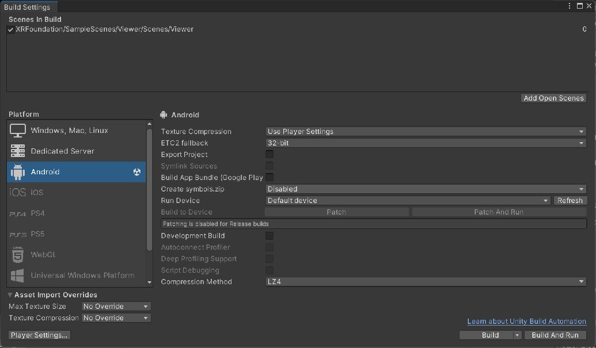

# SiNGRAY G2 Native SDK

Native SDK and Unity integration for SiNGRAY G2 AR devices, including Android native libraries, MRTK2 integration, sensor APIs, and sample applications.

## Documentation

- [Release Notes](RELEASE_NOTES.md): versioned development changes since October 6, 2026, validation results, and upgrade notes.
- [Demo and User Guide](Docs/Demo-and-User-Guide.md): environment setup, demo scenes, Android builds, device operation, integration, and troubleshooting.
- [API Reference](Docs/API-Reference.md): product interfaces, sensor settings, events, data types, Foundation feature managers, and native interop guidance.
- [Keys and MRTK Buttons](Docs/Keys-and-Buttons.md): device-key setup, default mappings, MRTK press-cycle protection, and verification steps.
- [Key Input API Guide](Assets/XRFoundation/Core/Input/README.md): complete C# examples, mapping profiles, event lifecycle, and simulation.

## SiNGRAY G2 Configure for Windows

SiNGRAY G2 Configure is a Windows desktop companion for managing G2 devices over USB or a local network. Use it to install apps, transfer files, preview and download photos or videos, perform device OTA updates, and access device controls and diagnostic logs.

**Configure version: 2.3.8.16**

- [Download the Windows installer](https://github.com/HMS-Unity/SiNGRAY_G2_NativeSDK/releases/download/configure-v2.3.8.16/SiNGRAY_G2Configure_Setup_2.3.8.16.exe)
- [Download the English Quick User Guide](https://github.com/HMS-Unity/SiNGRAY_G2_NativeSDK/releases/download/configure-v2.3.8.16/01_User_Manual_EN.html) — open the downloaded HTML in a browser; all screenshots are embedded.
- [Release details and installation notes](https://github.com/HMS-Unity/SiNGRAY_G2_NativeSDK/releases/tag/configure-v2.3.8.16)

Run the installer, open Configure, and select your connected G2 device. Configure has its own version number, separate from the Native SDK version below.

## Development branch

The `dev/4.2` branch contains the `4.2.0.2` development project. Use Unity **2022.3.62f3** with Android Build Support. This is the recorded Unity 2022 editor version; Unity 6 migration is not part of this branch. The current Android configuration uses IL2CPP, ARM64, minimum API 30, and target API 35.

```sh
git lfs install
git clone --branch dev/4.2 git@github.com:HMS-Unity/SiNGRAY_G2_NativeSDK.git
cd SiNGRAY_G2_NativeSDK
git lfs pull
git lfs fsck
```

Open the repository root in Unity Hub and allow package import to finish. The current enabled build scene is `Assets/XRFoundation/SampleScenes/Viewer/Scenes/Viewer.unity`. For the categorized demo hub, open `Assets/XRFoundation/SampleScenes/SDKSampleHub/Scenes/SDKSamples.unity` and configure it as the entry scene in Build Settings.

### Android entry scene



Actual Editor screenshot captured on October 7, 2026. It shows the Android target and Viewer entry scene, not an APK build result or live device output. To test the reported sample issues, replace the entry scene with `SDKSamples.unity` before building.

## Current integration changes

- Consolidated the 19 additional `xv-wrapper` bindings into the global `API` class. Update callers of the removed `XvNativeAPI` class to use `API`.
- Moved `XvGazeButton` to `Singray.UI.Input` while preserving its asset identity.
- Removed the obsolete branding postprocessor, legacy Java demo activities, and AI Talk implementation and sample. Required native libraries and the separate speech examples remain.
- Updated RGBD preview setup, ToF point-cloud display startup, plane-detection initialization and parsing, and spatial-map callback and native-memory handling.

## Validation status

Managed runtime and Editor compilation completed with no errors; existing warnings remain. Eight plane-parser checks passed. RGBD, ToF Point Cloud, Plane Detection, and Spatial Map still require regression testing on G2 hardware. These code changes do not establish that the reported device failures are resolved.

This is a development build. Editor simulation does not validate native device behavior; test the selected features on the target G2 hardware and firmware before deployment. See the [device regression checklist](Docs/Demo-and-User-Guide.md#device-regression-checklist) for expected results and evidence to collect.
